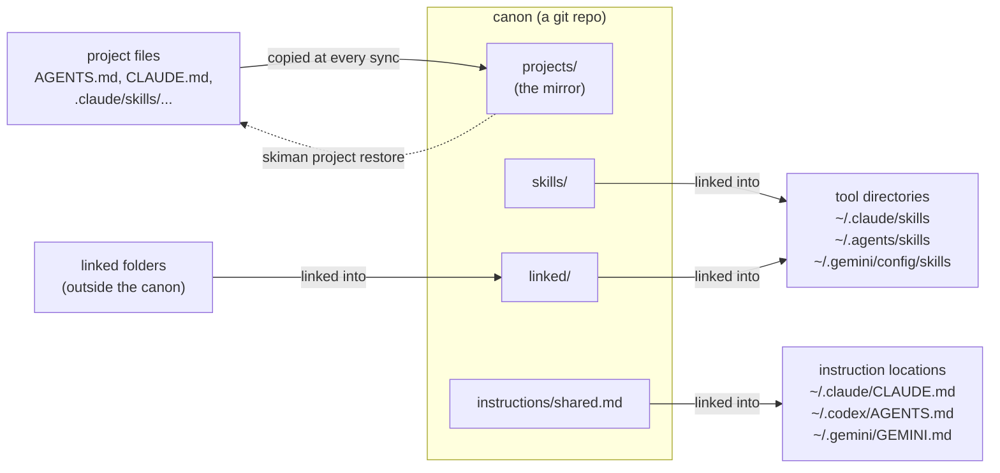

# skiman

One git repo for your agent skills and global instructions, linked into
every agent tool that reads them.

Claude Code, Codex and Antigravity each read skills from their own folder
and global instructions from their own file. Kept by hand, the copies
drift apart and nothing records what changed. skiman keeps one copy of
each in a single git repo of yours, the canon, and links it into every
tool. Git keeps the history; skiman checks each commit and keeps the
links in step with the canon.



What the canon tracks:

- Own skills, which you write by hand.
- Third-party skills, tracked against their upstream: `skiman update`
  merges a new upstream version and keeps your local modifications.
- Linked folders: folders of skills kept outside the canon, such as a
  team's, which skiman distributes and never writes.
- The shared body of the global instructions, `instructions/shared.md`.
- A versioned copy of the project instruction files and project skills
  you adopt under the folders you register (`AGENTS.md`, `CLAUDE.md`,
  `.claude/skills/<n>` in each project).

Content skiman does not own is replaced only by `skiman adopt` and
`skiman import`, and the originals go to a backup.

## Requirements

- macOS or Linux; CI runs both. Windows is not supported.
- Rust 1.99 or later and git 2.43 or later.

## Install

```sh
cargo install --locked --path .
```

Install a new version on every machine that uses the canon before you
commit what it adds: keys and tables of `skiman.toml` (such as `summary` or
`[linked.<id>]`), which older versions report as unknown, or group folders
under `skills/` (nested ones too), which older versions read as skill folders
without a `SKILL.md`. The pre-commit hook of an older version then refuses
the commit.

## Quick start

1. `skiman init ~/skills --session-hooks claude-code` creates the canon at
   `~/skills` with `git init`, installs its git hooks and a session-start
   hook for Claude Code, and links the built-in `skiman-manual` skill and
   the shared body into every agent tool on this machine. Name your own
   tools' ids, comma-separated (such as `claude-code,antigravity`; skiman
   adds no hook for Codex yet, see
   [Codex and Antigravity](#codex-and-antigravity)), or `none`. A skill
   folder or global instruction file already there stays as it is: `init`
   reports it, and exits 3 when an existing file or name is in the way of
   a link (a global instruction file, or an entry named like a skill
   skiman links).
2. `skiman new <name> -d <description>` creates an own skill;
   `skiman add <owner>/<repo>` installs third-party skills. Either links
   the new skills into every tool directory.
3. Edit the skill's `SKILL.md`, or `instructions/shared.md`, in the canon.
   The tools see the edit at once, through the links.
4. Commit in the canon, as in any git repo. The pre-commit hook runs
   `skiman check --staged` and refuses a commit that breaks a rule.

Skills or global instructions already in your agent tools?
`skiman import --guide` prints how to bring them in. To try skiman first
without touching them, see [Verify the install](#verify-the-install).

## Usage

| Command | What it does |
|---|---|
| `skiman init <path> --session-hooks <ids>\|none` | Create or reuse a canon, install its git hooks and session-start hooks (`<ids>` comma-separated), then sync. |
| `skiman new <name> -d <description>` | Create an own skill (`--group`). |
| `skiman add <source>` | Install third-party skills from a git URL, a GitHub tree URL, `<owner>/<repo>` or a local folder (`--skill`, `--all`, `--name`, `--group`, `--ref`, `--dry-run`, `--yes`). |
| `skiman update [names]` | Merge each third-party skill's new upstream version with its local modifications (`--ref` for one skill, `--dry-run`). |
| `skiman diff <name>` | Show a third-party skill's local modifications. |
| `skiman remove <name> --yes` | Remove a skill; its folders go to a backup. |
| `skiman mv <old> [<new>]` | Rename a skill and its records, or move it to another group folder (`--group`, `--no-group`). |
| `skiman adopt <name> --from <tool id> --yes` | Bring a foreign skill from a tool directory into the canon (`--group`). |
| `skiman import [folder] --yes` | Import a prepared folder (default `<canon>/.skiman/import/`); `--guide` prints how to prepare one. |
| `skiman sync` | Make every tool directory and instruction location match the canon (`--hook` from hooks). |
| `skiman check` | Report every rule violation in the canon (`--staged` for the git index). |
| `skiman list` | Show every skill with its kind, source, version and state. |
| `skiman overview` | Show every skill on this machine as Markdown: by group with summary, source and install day, each linked folder, then the skills other managers keep (read-only). |
| `skiman doctor` | Diagnose the setup, linked folders and project roots included. |
| `skiman linked add <path>` | Register a linked folder and distribute its skills (`--id`). |
| `skiman linked remove <id>` | Stop distributing a linked folder; its content stays. |
| `skiman project add <path>` | Register a project root (`--id`). |
| `skiman project adopt [paths]` | Copy project items into the mirror under `projects/` (`--dry-run`, `--yes`). |
| `skiman project restore <paths>` | Write mirror items to the project (`--dry-run`, `--yes`). |
| `skiman project eject <paths>` | Stop managing project items; the project files stay (`--yes`). |

### Groups

A folder under `skills/` without a `SKILL.md` that holds only folders is a
group folder: every folder in it is a skill in that group
(`skills/<group>/<name>`), or an inner group folder, so the folder tree shows
how the skills are grouped. Groups nest to any depth
(`skills/third-party/tstack/<name>`, `--group third-party/tstack`). A group
folder's name follows the skill-name rule and is no skill's name. A skill
directly under
`skills/` is in no group, and `skiman check` reminds you of it. Tool
directories stay flat: each skill is linked under its own name, wherever its
folder sits, so skill names are unique across groups. Moving a skill to
another group (`skiman mv <name> --group <group>`, or by hand followed by
`skiman sync`) changes no record. Why: [docs/adr/0008-groups-are-folders.md](docs/adr/0008-groups-are-folders.md), [docs/adr/0009-groups-nest.md](docs/adr/0009-groups-nest.md).

### Linked folders

A linked folder is a folder of skills kept outside the canon, such as a
team's skills in a work folder. skiman distributes its skills like the
canon's and never writes into it.

- `skiman linked add <path>` registers the folder as `[linked.<id>]` in
  `skiman.toml`, links it into the canon as `linked/<id>`, and links each of
  its skills into every tool directory. The path is one skill folder, or a
  folder whose child folders are skills (one level deep). The id is the
  folder's name, or its parent's name for a folder called `skills`; `--id`
  sets another.
- The path must be an existing folder. It must not be your home or a folder
  above it, and it must not overlap the canon, a tool directory or another
  linked folder.
- `linked add` adds `/linked/` to the canon's `.gitignore`, so linked content
  never enters the canon's history.
- Edit a linked skill in its own folder or through `linked/<id>`. An edit
  takes effect without a sync. The next sync links a skill added to the
  folder and removes the link of a skill deleted or renamed there.
- A linked skill's summary is `metadata.summary` in its own `SKILL.md`.
  `linked add` prints the lines to add for each skill that has none. Until
  then, `skiman overview` shows the first sentence of its description,
  marked as a stand-in.
- skiman never writes into a linked folder. `update`, `diff`, `remove` and
  `mv` refuse a name that is only a linked skill and name its folder.
  `new`, `add`, `adopt`, `import` and `mv` refuse to create a skill or a
  group folder with a linked skill's name.
- Each write is checked right before it happens, and again after any wait
  for your answer. What it does not guard against is in
  [ADR 0010](docs/adr/0010-linked-folders-beside-skills.md).
- A name used by a skill in `skills/` and by a linked skill goes to the one
  in `skills/`; a group folder's name is taken the same way. Between two
  linked folders, the id that sorts first wins. sync, `skiman check` and
  `skiman doctor` report each such collision.
- While a linked folder, or a linked skill's `SKILL.md`, cannot be read,
  its links stay as they are and keep their names, even against a new
  skill in `skills/`. sync, `skiman check` and `skiman doctor` report the
  skill folder that waits. The first sync that can read it again applies
  the rule above.
- To move the folder, move it and change its `path` line in `skiman.toml`.
  The next sync links it again. A sync between the two steps sees the
  folder missing and removes its links until then.
- To stop using the folder, run `skiman linked remove <id>`. It removes the
  table, `linked/<id>` and every link to its skills, and `linked/` when it
  is empty and no linked folder is left. The folder's content stays.
- On a machine where the folder does not exist, sync reports it and goes
  on (the session-start hook reports it once). The skills come back when
  the folder does. Each machine has its own checkout of the canon, and
  `~/` in a `path` expands on each.

Why: [docs/adr/0010-linked-folders-beside-skills.md](docs/adr/0010-linked-folders-beside-skills.md),
[docs/adr/0011-linked-skill-summary-in-its-skill-md.md](docs/adr/0011-linked-skill-summary-in-its-skill-md.md).

### Project instruction files and project skills

Project items stay real files in the project, where people and agents edit
them. `skiman sync` (also run at session start and by the git hooks) copies
every change into the mirror `projects/<id>/<path>`, so the canon
records their history once you commit. The project is written only by
`skiman project restore`, and whatever skiman replaces on either side goes to
a backup. An item edited on both sides is reported as a conflict, never
overwritten; settle it per item with `adopt <item>` (project wins) or
`restore <item>` (mirror wins). A folder given to any of these commands never
replaces existing content. Files a project's own git repo tracks are left to
that repo. Design and evidence: [docs/project-scope.md](docs/project-scope.md),
[docs/adr/0006-project-items-in-copy-mode.md](docs/adr/0006-project-items-in-copy-mode.md).

## How skiman works

skiman changes files in the canon and never commits: you review a change
with `git status` and `git diff` and commit it yourself. The canon's git
hooks run `skiman check --staged` before each commit, and
`skiman sync --hook` after each commit, merge, checkout and rebase; a
session-start hook runs `skiman sync --hook` when an agent session
starts. `sync --hook` prints only what it has not reported before and
always exits 0, so it never blocks git or a session.

Without a terminal, every flag that would otherwise be asked for is required
(exit 2). Exit codes: 0 success, 1 rule violation or refused input, 2 usage
error, 3 needs attention, 4 operational error.

### What skiman keeps on each machine

Outside the canon, in `${XDG_STATE_HOME:-~/.local/state}/skiman/`:

- `backups/<timestamp>/`: what one command replaced or removed. skiman
  never deletes what a backup holds, and each project edit that sync
  copies into the mirror adds one, so delete old ones by hand.
- `cache/`: one bare git repo per upstream URL, holding every commit `add`,
  `update` and `import` fetched, whole even when the source names one
  folder of the repo. Nothing prunes it; delete `cache/` to free the
  space, and the next command that needs a commit fetches it again.

`skiman add`, `skiman update` and `skiman import` read a local source
folder as it is at that moment. A program that changes the folder while
skiman reads it, say by replacing a file with a symlink, can make skiman
copy a file from outside it, so add or import only from folders you
trust.

### Codex and Antigravity

skiman adds no session-start hook for Codex yet: Codex runs only the hooks
you have trusted with its `/hooks` command. Run `skiman sync` before you
start a Codex session, or rely on the canon's git hooks, which run it
after each commit, merge, checkout and rebase there. Evidence:
[docs/phase1-results.md](docs/phase1-results.md).

For Antigravity, `--session-hooks antigravity` adds a hook named `skiman`
to `~/.gemini/config/hooks.json`. Antigravity runs it when a conversation
starts, but only after it has read the skills for the first prompt. A skill
the hook links is there from the next prompt (with `agy -p`, from the next
run), and a resumed conversation does not run the hook. So after you add or
rename a skill, run `skiman sync` before you start an Antigravity session.
When the hook has something to report, Antigravity expects JSON, logs a
parse error and goes on: the report reaches neither you nor the model, and
`skiman sync` or `skiman doctor` shows it. Antigravity also cuts a skill's
body after 24000 bytes without a message, so while it is enabled skiman
warns about a longer one.

The `agy` CLI, `agy -p` and `agy acp` alike, loads every skill and global
instruction file skiman distributes. T3 Code's own Antigravity runtime loads
the skills but not the global instruction files; that is outside skiman.
Evidence: [docs/project-scope-evidence.md](docs/project-scope-evidence.md).

## Verify the install

1. Run `skiman --version`.
2. Try `skiman init` in a throwaway home, so your real agent tools stay
   untouched (the parentheses keep your shell's `HOME` as it is):

   ```sh
   (
     export HOME=$(mktemp -d) XDG_CONFIG_HOME= XDG_STATE_HOME=
     mkdir "$HOME/.claude"
     skiman init "$HOME/skills" --session-hooks none
     skiman doctor
     ls -l "$HOME/.claude/skills"
   )
   ```

   `doctor` reports the canon and Claude Code as installed, and
   `~/.claude/skills/skiman-manual` is a link into the canon.

   Or run `skiman init <path> --session-hooks none` on a real canon path,
   then `skiman doctor`.

## Uninstall

1. Set `enabled = []` under `[tools]` in the canon's `skiman.toml`, then run
   `skiman sync`: it removes every link it made in the tool directories and
   instruction locations. Do not commit this edit while other machines use
   the canon: their next sync would remove their links too.
2. Run `skiman init <canon> --session-hooks none` to remove the
   session-start hooks.
3. Step 1 removed every link, so copy back what you still want:
   `instructions/shared.md` to each instruction location (such as
   `~/.claude/CLAUDE.md`), and the folder of each skill under `skills/`
   into the tool directories (such as `~/.claude/skills/<name>`).
4. Delete the git hooks skiman installed in the canon, the files that
   `grep -l 'Managed by skiman' <canon>/.git/hooks/*` lists. Without
   skiman, its pre-commit hook refuses every commit.
5. Delete `${XDG_CONFIG_HOME:-~/.config}/skiman/`, and
   `${XDG_STATE_HOME:-~/.local/state}/skiman/` once you no longer need its
   backups.
6. Run `cargo uninstall skiman`.
7. In the canon, run `git restore skiman.toml` to drop the edit of step 1.

Project files and linked folders stay as they are, and the canon stays a
plain git repo.
